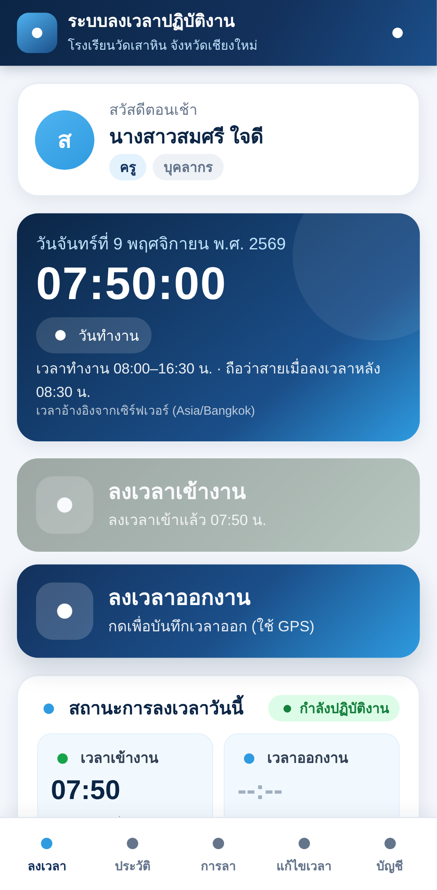
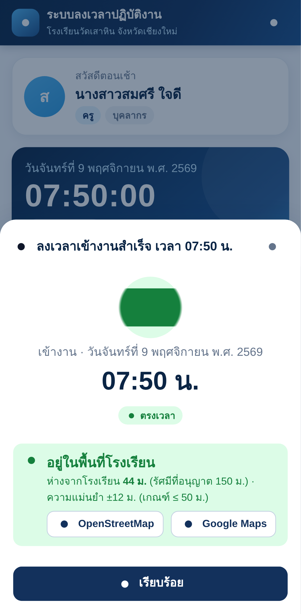
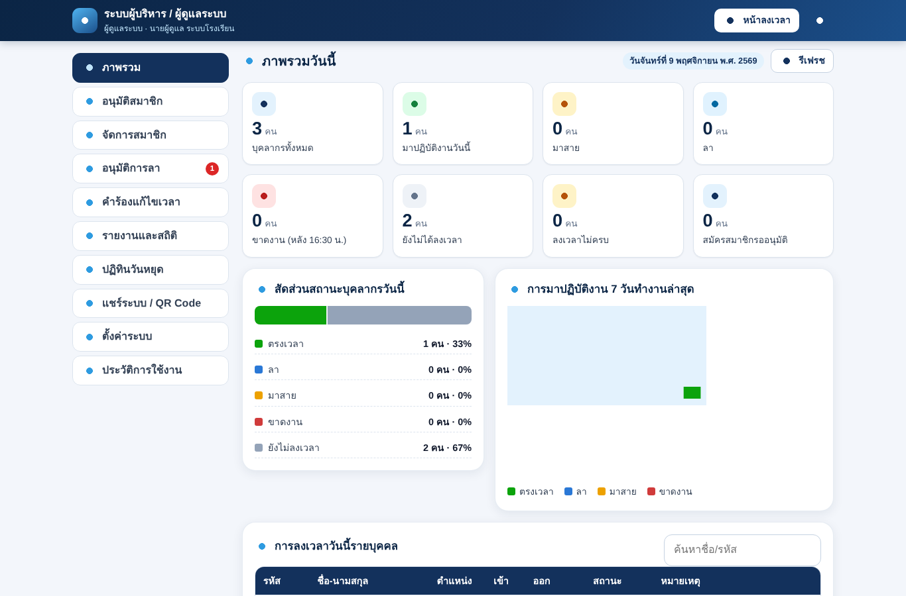

# ระบบลงเวลาปฏิบัติงานออนไลน์ โรงเรียนวัดเสาหิน จังหวัดเชียงใหม่

**Wat Sao Hin School Attendance System** — *ระบบลงเวลาอัจฉริยะ สะดวก โปร่งใส ตรวจสอบได้*

เว็บแอปลงเวลาเข้า-ออกงานด้วย GPS สำหรับครูและบุคลากร พร้อมระบบสมาชิก การลา คำร้องแก้ไขเวลา Dashboard ผู้บริหาร และรายงานรายวัน/รายเดือน/รายปี/รายบุคคล (Export Excel, PDF, พิมพ์)
พัฒนาด้วย **Google Apps Script + Google Sheets + Google Drive** — **ไม่มีค่าใช้จ่ายรายเดือน** ไม่ต้องเช่า Hosting หรือซื้อโดเมน เปิดใช้งานผ่าน URL ของ Apps Script ได้ทันที

| มือถือ: ลงเวลา | มือถือ: ลงเวลาสำเร็จ | ผู้ดูแล: ภาพรวม |
|---|---|---|
|  |  |  |

<sub>ภาพจากการทดสอบอัตโนมัติใน sandbox ที่ไม่มีอินเทอร์เน็ต — ไอคอนจึงแสดงเป็นจุด และใช้ฟอนต์ไทยของระบบแทน Sarabun</sub>

## ความสามารถหลัก

- **ลงเวลาเข้า/ออก** (ลงเวลาเข้าตรวจ GPS เสมอ; ลงเวลาออกเลือกได้ว่าตรวจ GPS หรือไม่ — ค่าเริ่มต้นไม่ตรวจ) — Server ตรวจระยะห่างจากโรงเรียน (สูตร Haversine) และค่าความแม่นยำ ใช้ **เวลาของ Server (Asia/Bangkok)** เท่านั้น, 1 วัน เข้า 1 ครั้ง ออก 1 ครั้ง, ออกก่อนเข้าไม่ได้, กันกดซ้ำด้วย LockService, แสดงระยะห่าง (เขียว/แดง) และลิงก์แผนที่ OpenStreetMap/Google Maps, ใช้ GPS เฉพาะตอนกดปุ่ม
- **ติดตั้งง่าย** — วาง 3 ไฟล์แล้ว Deploy ระบบสร้างฐานข้อมูลเองเมื่อเปิดเว็บครั้งแรก และมีหน้าตั้งค่าครั้งแรกที่ป้องกันด้วยรหัสติดตั้งซึ่งเห็นได้เฉพาะเจ้าของบัญชี
- **สมาชิก** — สมัครเอง (ไม่ต้องกรอกรหัสบุคลากร ระบบกำหนดให้ T001, T002, …) → รออนุมัติ, ลืมรหัสผ่านส่งคำขอให้ผู้ดูแลรีเซ็ตได้จากหน้าเข้าสู่ระบบ, ตรวจ Username/รหัสบุคลากรซ้ำ, เกณฑ์รหัสผ่าน, Admin เพิ่ม/แก้ไข/ปิดใช้งาน/ลบ/เปลี่ยนสิทธิ์/รีเซ็ตรหัสผ่าน (รหัสชั่วคราวสุ่ม + บังคับเปลี่ยน)
- **แจกระบบให้ครูง่าย** — หน้า **แชร์ระบบ / QR Code**: พิมพ์ประกาศ QR (A4), ข้อความพร้อมส่งกลุ่ม LINE, **เพิ่มบุคลากรหลายคน** จากรายชื่อใน Excel แล้ว **พิมพ์บัตรเข้าใช้งาน** (ชื่อผู้ใช้ + รหัสผ่านชั่วคราว + QR) — QR Code สร้างในระบบเอง ไม่พึ่งบริการภายนอก
- **ลืมลงเวลาก็แก้ง่าย** — กดลงเวลาเข้าหลังเวลาสาย ระบบถาม “ลืมกด?” แล้วแจ้งเวลาที่มาถึงจริงได้ (ลงเวลาออกตอนเย็นได้ระหว่างรออนุมัติ), ผู้บริหาร **บันทึกเวลาแทน** ได้ทันทีจากตารางวันนี้
- **ใช้ง่ายสำหรับทุกคน** — กล่อง **ลงเวลาไม่ครบ** บนหน้าแรกพร้อมปุ่มแก้ไข/แจ้งลาแตะเดียว (กรอกวันที่ให้), **จำการเข้าสู่ระบบบนโทรศัพท์** (เปิดแอปแล้วกดลงเวลาได้เลย ไม่ต้องใส่รหัสผ่านทุกวัน), แนะนำ **เพิ่มไอคอนบนหน้าจอ**, ปุ่มลัด **แจ้งลา / ลืมลงเวลา** ใต้ปุ่มลงเวลา, **ปรับขนาดตัวอักษร** ปกติ/ใหญ่/ใหญ่มาก, ออกจากระบบทุกเครื่องเมื่อโทรศัพท์หาย
- **ความปลอดภัย** — PBKDF2-HMAC-SHA256 + Salt + Pepper, Session หมดอายุ, ล็อกเมื่อใส่รหัสผิดซ้ำ, ตรวจสิทธิ์ที่ Server ทุกคำสั่ง (3 บทบาท: บุคลากร/ผู้บริหาร/ผู้ดูแลระบบ), Audit Log, ไม่ลบประวัติการลงเวลา, ไม่มีรหัสผ่านเริ่มต้นในโค้ด
- **การลาแบบแตะครั้งเดียว + ยืนยัน** (ป่วย/กิจ/พักผ่อน/ลาคลอดบุตร/ไปราชการ/อื่น ๆ พิมพ์เอง, ครึ่งวัน, ย้อนหลัง/ล่วงหน้า, เอกสารแนบ), ผู้ดูแลบันทึกการลาให้ครูได้, เลือกได้ว่าต้องรออนุมัติหรือมีผลทันที และ **คำร้องแก้ไขเวลา** พร้อมการอนุมัติ
- **พิมพ์ใบลาตามแบบของทางราชการ** (แบบใบลาป่วย ลาคลอดบุตร ลากิจส่วนตัว / แบบใบลาพักผ่อน) เติมข้อมูลและ **สถิติการลาในปีงบประมาณ** ให้อัตโนมัติ, สถิติการลาของตนเองแยกรอบการประเมิน, และ **บัญชีสรุปวันลา/มาสาย/ขาดงานรายรอบการประเมิน** (1 ต.ค.–31 มี.ค. / 1 เม.ย.–30 ก.ย.) สำหรับผู้บริหาร
- **วันหยุดราชการไทยในปฏิทินอัตโนมัติ** (พ.ศ. 2569 ครบทุกวัน, 2570 ร่าง, ปีอื่นคำนวณวันหยุดชดเชยให้) และผู้ดูแลเพิ่ม/แก้ไข/ลบวันหยุดของโรงเรียนได้
- **ตั้งค่าได้ทั้งหมดจากหน้า Admin** — พิกัด/รัศมี/ความแม่นยำ GPS, เวลาเริ่มงาน/สาย/เลิกงาน, วันทำงาน, ปฏิทินวันหยุด, ระยะเวลาเก็บพิกัด ฯลฯ
- **Dashboard ผู้บริหาร** (การ์ดสถิติ + Chart.js) และ **รายงาน** หัวกระดาษทางการ
- **Mobile First**, ภาษาไทย, วันที่ พ.ศ.

## เริ่มต้นอย่างรวดเร็ว (ติดตั้งแบบง่าย ~10 นาที ไม่ต้องรันโค้ด)

1. เปิด <https://script.new> ด้วยบัญชี Google ของโรงเรียน
2. วางโค้ด **3 ไฟล์** จาก [`dist/`](dist/): `Code.gs`, `Index.html`, `Admin.html`
3. **Deploy → Web app** (Execute as: **Me**, Who has access: **Anyone**) → อนุญาตสิทธิ์ → ได้ URL
4. เปิด URL → ระบบสร้างฐานข้อมูลเอง → นำ **รหัสติดตั้ง** จากชีต “เริ่มต้นใช้งาน” ใน Google Drive มากรอก พร้อมสร้างผู้ดูแลระบบ/ตั้งพิกัด/เวลาทำงาน
5. แจก URL ให้ครูสมัครสมาชิก แล้วอนุมัติ

ทีละขั้นพร้อมคำอธิบาย: [ติดตั้งแบบง่าย](docs/00-quick-start.md) · แบบแยกไฟล์/clasp: [คู่มือติดตั้งฉบับเต็ม](docs/03-installation.md)

## เอกสาร

| # | เอกสาร | เนื้อหา |
|---|---|---|
| 0 | [**ติดตั้งแบบง่าย (แนะนำ)**](docs/00-quick-start.md) | วาง 3 ไฟล์ → Deploy → เปิดเว็บ → กรอกรหัสติดตั้ง |
| 1 | [วิเคราะห์ระบบ สถาปัตยกรรม ผังการทำงาน UI/UX](docs/01-architecture.md) | บทบาท/สิทธิ์, สถาปัตยกรรม, ผังงาน (Mermaid), นิยามสถานะ, โครงสร้างไฟล์, การออกแบบหน้าจอ |
| 2 | [โครงสร้าง Google Sheets](docs/02-database.md) | 9 ชีต ทุกคอลัมน์ + ชนิดข้อมูล, ค่าเริ่มต้น, Script Properties |
| 3 | [ติดตั้ง / สร้าง Admin คนแรก / Deploy / ตั้งค่า GPS](docs/03-installation.md) | ทีละขั้นตอน + แก้ปัญหา + สำรองข้อมูล |
| 4 | [คู่มือครูและบุคลากร](docs/04-user-guide.md) | สมัคร, เข้าสู่ระบบ, ลงเวลา, เปิด GPS, ลา, คำร้อง |
| 5 | [คู่มือผู้ดูแลระบบและผู้บริหาร](docs/05-admin-guide.md) | อนุมัติสมาชิก, จัดการสมาชิก, ลา/คำร้อง, รายงาน, ปฏิทิน, ตั้งค่า, Audit Log |
| 6 | [ความปลอดภัยและ PDPA](docs/06-security.md) | มาตรการ, ข้อจำกัดการ Hash รหัสผ่านใน Apps Script, ข้อจำกัด GPS, Checklist |
| 7 | [รายการทดสอบและผลการทดสอบ](docs/07-testing.md) | Backend 95 รายการ + End-to-End 33 รายการ (ทดสอบทั้งแบบแยกไฟล์และชุด 3 ไฟล์) + UAT บนระบบจริง |
| 8 | [ข้อจำกัดของบริการฟรีและข้อควรระวัง](docs/08-limitations.md) | โควตา Apps Script/Sheets/Drive, GPS, ข้อควรระวัง |
| 9 | [การพัฒนาและอัปเดตระบบ](docs/09-development.md) | ขั้นตอนอัปเดตเวอร์ชันโดยไม่เปลี่ยน URL, ย้อนกลับเวอร์ชัน, แนวทางพัฒนา |

## โครงสร้างโปรเจกต์

```
dist/                   ← ชุดติดตั้งแบบง่าย 3 ไฟล์ (สร้างจาก src/ ด้วย node tools/build-bundle.js)
  Code.gs Index.html Admin.html
src/                    ← โค้ดต้นฉบับแบบแยกไฟล์ (สำหรับนักพัฒนา/clasp)
  Code.gs               doGet, API router + ตารางสิทธิ์, ค่าคงที่, วันที่ พ.ศ.
  Auth.gs               สมัคร/เข้าสู่ระบบ/Session/เปลี่ยนรหัสผ่าน/CreateFirstAdmin
  Crypto.gs             SHA-256 / HMAC / PBKDF2 + Salt + Pepper
  Attendance.gs         GPS Geofencing (Haversine), ลงเวลา, Dashboard บุคลากร
  Leave.gs              การลา, คำร้องแก้ไขเวลา, ไฟล์แนบ
  Admin.gs              ภาพรวม, สมาชิก, ตั้งค่า, ปฏิทิน, Audit Log
  Reports.gs            คำนวณสถานะ, รายงาน, Export Excel/PDF
  Database.gs           Schema, SetupSystem(), CRUD, แคช, งานบำรุงรักษา
  Index.html Login.html Register.html Dashboard.html
  AdminDashboard.html AdminScript.html   ← ส่งให้เฉพาะผู้มีสิทธิ์
  Styles.html JavaScript.html appsscript.json
docs/                   ← เอกสารทั้งหมด + ภาพหน้าจอ
tests/                  ← ตัวจำลอง Apps Script + ชุดทดสอบ Backend/E2E + ผลการทดสอบ
tools/build-bundle.js   ← รวม src/ เป็นชุด 3 ไฟล์ใน dist/
tools/gen-db-doc.js     ← สร้างเอกสารโครงสร้างฐานข้อมูลจากโค้ด
```

## สำหรับนักพัฒนา

```bash
node tests/backend.test.js
```

```bash
node tests/e2e.test.js
```

```bash
node tests/e2e-server.js
```

คำสั่งสุดท้ายเปิดพรีวิวหน้าเว็บบนเครื่องที่ <http://localhost:8787> (ใช้ตัวจำลอง Apps Script + ข้อมูลตัวอย่าง; Admin: `admin.saohin` / `Adm1nStrong2026`) — ต้องมี Node.js 18+ และ Playwright สำหรับ E2E (`npm i -D playwright && npx playwright install chromium`)
แก้ไขโค้ดที่ `src/` แล้วรัน `node tools/build-bundle.js` เพื่อสร้าง `dist/` ใหม่ (ทดสอบชุด 3 ไฟล์ด้วย `GAS_SRC=dist node tests/backend.test.js`)
ผู้ใช้ [clasp](https://github.com/google/clasp) คัดลอก `.clasp.json.example` เป็น `.clasp.json` แล้ว `clasp push`

## ข้อจำกัดสำคัญ (โปรดอ่าน)

- การตรวจ GPS ผ่านเว็บ **ไม่สามารถป้องกันการปลอมพิกัดได้ทั้งหมด** ควรใช้ร่วมกับการกำกับดูแลของผู้บริหาร
- ค่าเวลาทำงาน/รัศมีเริ่มต้นเป็น **ค่าตัวอย่าง** ต้องปรับตามระเบียบของโรงเรียนก่อนใช้งานจริง
- โควตาของบริการฟรี Google และข้อควรระวังอื่น: [docs/08-limitations.md](docs/08-limitations.md)
